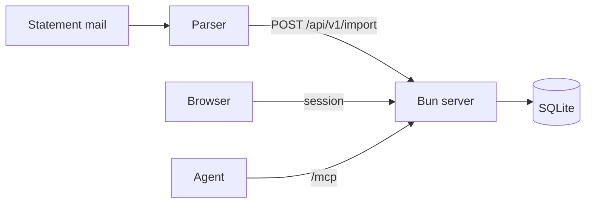

<div align="center">

<h1>finance</h1>

<p><strong>A personal finance ledger that reads bank statements and finds what repeats.</strong></p>

</div>

You send it your statements. It shows your net worth, where each month's money went, which subscriptions you pay and when each card is due. An agent reads the same numbers over MCP.

## Features

- **Import by API**: one call takes accounts, balances, card statements and transactions. Sending it twice changes nothing.
- **Statement parsers**: Cathay and Taishin credit cards; Taishin, E.SUN, SinoPac, Fubon and Next Bank savings; the Fubon student loan; SinoPac Securities holdings. Each parser checks its rows against the statement's own total.
- **Recurring charges**: finds subscriptions by merchant, day of month and amount, and gives the next date.
- **Card cycles**: closing day, due day, the day you usually pay, and the next due date.
- **Transfers**: money that leaves one account and reaches another counts once, not as a cost.
- **Inbox**: rows with no category wait for one click. The merchant's other rows follow.
- **Suggestions**: Claude guesses a category or a transfer for each new inbox merchant. A guess changes no number until you accept it. Claude sees the merchant name, one description and whether money came in or went out, never an amount or an account.
- **MCP**: 7 tools at `/mcp` for an agent to read the ledger and import into it.

## Quick start

```sh
bun install
bun run build
FINANCE_TOKEN=$(openssl rand -hex 32) bun run start
```

## Usage

Turn a statement PDF into text, then post it:

```sh
qpdf --password-file=<(pbpaste) --decrypt statement.pdf plain.pdf
pdftotext -layout plain.pdf statement.txt
FINANCE_TOKEN=<token> bun ingest/cli.ts --post https://finance.zyx.tw statement.txt
```

The CLI prints one line per file: the parser, the row count and whether the total matches. It does not post a statement whose total does not match.

Any other source posts JSON to `/api/v1/import`:

```json
{
  "source": "my-bank-2026-10",
  "accounts": [{ "id": "my-bank", "name": "My bank", "kind": "deposit" }],
  "balances": [{ "account": "my-bank", "date": "2026-10-31", "amount": 52000 }],
  "transactions": [{ "account": "my-bank", "date": "2026-10-05", "amount": -1200, "description": "Rent" }]
}
```

A negative amount left the account. A card's debt is a negative balance. Dates are `YYYY-MM-DD`.

## API

Every route takes `Authorization: Bearer <FINANCE_TOKEN>` or a signed-in browser session.

| Route | Does |
|-------|------|
| `POST /api/v1/import` | adds accounts, balances, statements and transactions |
| `GET /api/v1/summary?month=` | net worth, income, spending, savings rate, runway, categories, every month |
| `GET /api/v1/transactions?month=&account=&category=&q=&inbox=1` | lists transactions, newest first |
| `PATCH /api/v1/transactions/<id>` | sets `category`, or `kind` to `transfer` |
| `POST /api/v1/suggestions` | asks Claude about inbox merchants it has not seen |
| `POST /api/v1/suggestions/accept` | accepts the guesses, for `ids` or for every row |
| `GET /api/v1/recurring` | subscriptions with the next date and the monthly total |
| `GET /api/v1/cards` | each card's cycle and next due date |
| `GET /api/v1/accounts` | accounts with the latest balance |
| `POST /mcp` | MCP over HTTP, token only |

## Configuration

| Key | Sets | Default |
|-----|------|---------|
| `FINANCE_ORIGIN` | the app origin, also the sign-in token audience | `http://localhost:8080` |
| `FINANCE_TOKEN` | the bearer token for importers and MCP, 32 characters or more | off |
| `FINANCE_ANTHROPIC_KEY` | the Anthropic API key for suggestions | off |
| `FINANCE_AUTH_ORIGIN` | where sign-in happens | `https://auth.zyx.tw` |
| `FINANCE_DATA` | the folder for the database | `./data` |
| `FINANCE_DIST` | the built web app | `./dist` |
| `FINANCE_PORT` | the listen port | `8080` |
| `OTEL_EXPORTER_OTLP_ENDPOINT` | where OTLP/HTTP JSON logs go | off |

## How it works



## License

[MIT](LICENSE)
